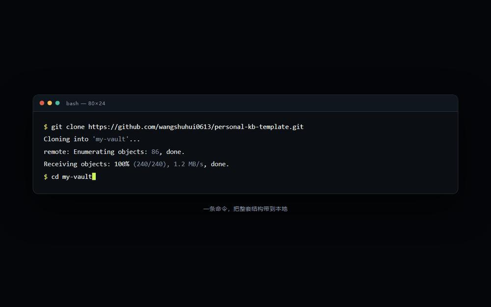
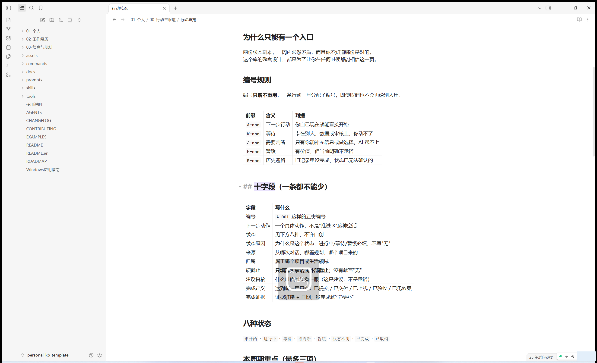
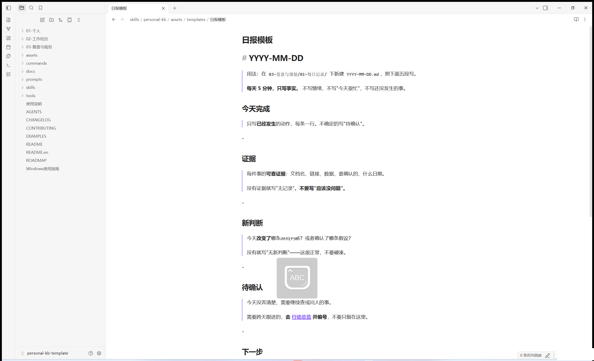
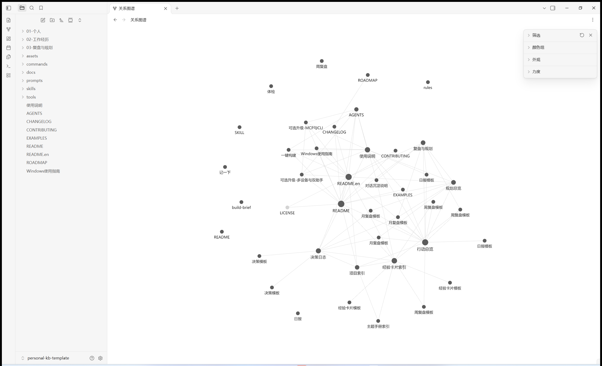
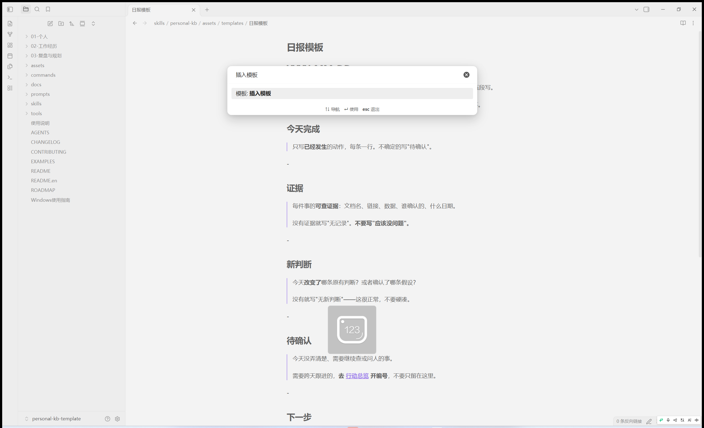

# Personal Knowledge Base Template

[](LICENSE)
[](https://github.com/wangshuhui0613/keep-the-why/stargazers)
[](https://github.com/wangshuhui0613/keep-the-why/actions/workflows/health-check.yml)
[](https://wangshuhui0613.github.io/keep-the-why/)

**English** | [中文](README.md)

An Obsidian vault structure for managing **plans, actions, evidence, reviews, and lessons learned**.

It is not a bookmark dump. Bookmarks solve "storing". This template solves "**using**" — so that six months from now, you can still answer: *why did I decide that back then?*

> **Privacy promise: all data stays on your own machine.** This repo collects, uploads, and syncs nothing — a clone is nothing but plain local files, fully usable offline.

The method has a name: **Action Ledger** — run your knowledge base like a ledger: one status entry, five account types, four completion levels, three kinds of receipts. Details in "Key Designs" below.



## Table of Contents

- [Four Questions It Answers](#four-questions-it-answers)
- [Structure](#structure)
- [Quick Start](#quick-start)
- [Day One: Three Things Only](#day-one-three-things-only)
- [Daily Use](#daily-use)
- [Who It's For](#who-its-for)
- [Key Designs](#key-designs)
- [Health Check](#health-check)
- [Live Preview](#live-preview)
- [Screenshots](#screenshots)
- [Just Want a Clean Vault?](#just-want-a-clean-vault)
- [Multiple Computers / Multiple Assistants](#multiple-computers--multiple-assistants)
- [Template Updates](#template-updates)
- [Migrating an Existing Vault (/adopt)](#migrating-an-existing-vault-adopt)
- [When NOT to Use This](#when-not-to-use-this)
- [FAQ](#faq)
- [Credits](#credits)
- [Contributing](#contributing)
- [Star History](#star-history)
- [License](#license)

## Four Questions It Answers

| Question | Where the answer lives |
|---|---|
| What should I do right now? | [Action Dashboard](01-个人/00-行动与跟进/行动总览.md) |
| What did I do before, and why did I judge it that way? | [Project Index](02-工作经历/00_总览/项目索引.md), [Decision Log](02-工作经历/01_决策日志/决策日志.md) |
| Which lessons can I reuse directly? | [Experience Cards Index](02-工作经历/03_经验卡片/经验卡片索引.md) |
| What phase am I in, and where next? | [Review & Planning](03-复盘与规划/复盘与规划.md) |

What keeps them turning is one loop:

```text
plan → act → evidence → review → lessons → adjust plans and actions
```

## Structure

```text
README.md / README.en.md / 使用说明.md (in Chinese) / Windows使用指南.md (in Chinese)
EXAMPLES.md (in Chinese) / CHANGELOG.md (in Chinese) / ROADMAP.md (in Chinese) / CONTRIBUTING.md (in Chinese) / AGENTS.md (in Chinese) / LICENSE
│
├── 01-个人/               direction, planning, cross-day actions
│   ├── 00-行动与跟进/
│   │   └── 行动总览.md    ★ the single source of truth for all ongoing actions
│   ├── 规划总览.md         life, career, learning, project planning
│   ├── 01-职业与成长/      career direction, competency models, study plans
│   ├── 02-生活与体验/      health, travel, wishes, life arrangements
│   ├── 03-自我认知/        values, strengths, limits, long-term questions
│   └── 04-个人项目与作品/  blog, portfolio, side projects
│
├── 02-工作经历/            projects, decisions, lessons, raw material
│   ├── 00_总览/项目索引.md        phases and entries of all projects
│   ├── 01_决策日志/决策日志.md     what was chosen, what was given up
│   ├── 02_主题手册/主题手册索引.md  cross-project playbooks
│   ├── 03_经验卡片/经验卡片索引.md  one card, one reusable conclusion
│   ├── 04_日报素材/                raw daily material (read-only)
│   ├── 05_文档原文/                PRDs, meeting notes (read-only)
│   ├── 06_数据/                    tables, metric definitions
│   ├── 07_附件/                    images, PDFs (read-only)
│   └── 99_元信息/                  sources, credibility, gaps
│
├── 03-复盘与规划/          daily evidence, periodic reviews, next phase
│   ├── 复盘与规划.md        review chain entry point
│   ├── 01-每日记录/         what happened today, with what evidence
│   ├── 02-周复盘/ 03-月复盘/ 04-季复盘/ 05-年复盘/
│   ├── 06-规划/             mid- and long-term plans
│   ├── 07-对话沉淀/         long-term conclusions mined from AI chats
│   └── 99-模板/             five templates: daily, weekly, monthly, decision, experience card
│
├── .obsidian/      preconfigured: template folder, daily note format, attachment path
│
│   # ↓ "AI & presentation assets" below — for AI and showcase use, safe to delete
│
├── prompts/         build instructions for your AI
├── skills/         Agent Skill (installable via npx skills add)
├── commands/       four named slash commands (after the Claude Code plugin install)
├── tools/          health check script
├── docs/           online product demo (GitHub Pages)
├── assets/         social cover image and README screenshots
├── .claude-plugin/ Claude Code plugin marketplace manifest
└── .github/        CI, issue / PR templates, dependabot
```

## Quick Start

**Requirements**: [Obsidian](https://obsidian.md) (free). No community plugins needed — stock features are enough.

> The health check script needs Python, but that's an **optional step** — without Python you simply can't run the check; the vault works and maintains fine.

### Option 1: Clone and use directly

```bash
git clone https://github.com/wangshuhui0613/keep-the-why.git my-vault
```

Open it in Obsidian via "Open folder as vault". Templates, daily notes, and attachment paths are **already configured**:

- `Ctrl/Cmd + P` → "Insert template" → pick one of the five templates (daily / weekly / monthly / decision / experience card)
- Click the calendar icon on the left; today's daily note is created in `03-复盘与规划/01-每日记录/`
- Pasted images automatically land in `02-工作经历/07_附件/`

Then do three things:

1. In `01-个人/规划总览.md`, write down the **one** direction that matters most for the next three months
2. In `01-个人/00-行动与跟进/行动总览.md`, write the **three** actions you can push forward this week
3. Delete all content marked as examples

### Option 2: Install as an Agent Skill, let AI build and maintain it

Fastest, one command (needs Node.js):

```bash
npx skills add wangshuhui0613/keep-the-why
```

`skills` is the standard install command of the Agent Skills ecosystem, supporting Claude Code, Codex, Cursor and 75+ agents.

> The install pops up a "which agents do you want to install to?" menu — when unsure, select all. For non-interactive install in scripts: `npx skills add wangshuhui0613/keep-the-why --agent '*' -y`.

Claude Code users can also use the plugin marketplace (either way works):

```bash
claude plugin marketplace add wangshuhui0613/keep-the-why
claude plugin install personal-kb@keep-the-why
```

Prefer not to use npx? Copy the whole `skills/personal-kb/` directory into your agent's skills directory:

| Platform | Project-level | Global |
|---|---|---|
| Generic Agent Skills convention (where `npx skills add` installs) | `.agents/skills/` | `~/.agents/skills/` |
| Claude Code | `.claude/skills/` | `~/.claude/skills/` |
| Cursor | `.cursor/skills/` | `~/.cursor/skills/` |
| Codex | `.codex/skills/` | `~/.codex/skills/` |
| GitHub Copilot | `.github/skills/` | `~/.copilot/skills/` |

Then just say "help me set up a knowledge base", or day to day, "note this down for me".

### Option 3: No Skill, just copy one prompt

Open [一键构建](prompts/一键构建.md) (in Chinese), copy the whole block from "开始" to "结束" to your AI assistant, and it will build the vault step by step and give you verification results.

## Day One: Three Things Only

Whichever option you picked, day one is these three things, five minutes each:

1. **Write your first daily note.** Click the calendar icon in Obsidian, or just tell your AI "note down what I did today". What actually happened today is the only raw material this vault cannot fake.
2. **Put the thing on your mind into the Action Dashboard.** Give it an ID (`A-001`), write the next concrete action. From this second on, it has earned the right to be tracked.
3. **Run the health check once.** `python tools/vault_health_check.py --root .` (on Windows you can also double-click `tools/health-check.cmd`) to confirm the structure is intact.

After these three, the vault starts producing for you. Come back to "Daily Use" after a week.

---

## Daily Use

You only need to answer three questions:

```text
What actually happened today?
Which judgment of mine did it change?
What is the smallest next action?
```

The first feeds the daily note, the second feeds the review, the third feeds the Action Dashboard.

| What you want to record | Where it goes |
|---|---|
| Something to follow up across days | [Action Dashboard](01-个人/00-行动与跟进/行动总览.md) |
| Direction, plans | [Planning Overview](01-个人/规划总览.md) or the matching subfolder |
| Overall project background | [Project Index](02-工作经历/00_总览/项目索引.md) |
| A choice with trade-offs | `02-工作经历/01_决策日志/` |
| A reusable conclusion | `02-工作经历/03_经验卡片/` |
| What actually happened today | `03-复盘与规划/01-每日记录/` |
| Weekly / monthly / quarterly / yearly conclusions | the matching folder under `03-复盘与规划/` |

**Rhythm**: five minutes before finishing work each day for the daily note; weekends extract the weekly review from this week's daily notes; month end extracts the monthly review from the weekly reviews. Each layer is only extracted from the layer below — **never rewrite from memory**.

### With the Skill installed: just talk

What you say to your AI → what actually happens:

| You say | What happens |
|---|---|
| "Note this down: today I revised project A's plan, next step is booking a tech review" | Written into today's daily note (done + next step); anything cross-day automatically gets an ID in the Action Dashboard |
| "Add 'book the tech review' to the Action Dashboard as A-002" | A new action row, all ten fields filled per spec, status and deadline written clearly |
| "Record this decision: back then only two vendor quotes, we picked the pricier one…" | Written into the decision log with background, alternatives, constraints, and what was given up |
| "Save a lesson: check the data before changing requirements" | De-duplicated against the whole vault first, then an experience card (conclusion, conditions, limits) |
| "Write this week's review" | Reads all of this week's daily notes first; extracts only from them, never from memory |
| "Run a health check" | Runs `tools/vault_health_check.py`, reporting broken links, field problems, sensitive values |

Everything above also works manually — the Skill just remembers "where it goes and which fields are required" for you.

With the Claude Code plugin install, there are also four ready-made slash commands (definitions live in the repo's `commands/` directory, editable):

| Command | What it does |
|---|---|
| `/日报` | Write today's daily note (five sections) |
| `/周复盘` | Read all of this week's daily notes first, then extract the weekly review |
| `/记一下` | Put something into the Action Dashboard: dedupe → classify → fill all ten fields |
| `/体检` | Run the health check and read the results; investigate abnormal fluctuations |

## Who It's For

Same structure, different usage:

- **Developers / tech leads**: the decision log records technical choices — "what information did I have, what did I give up"; experience cards store pitfall conclusions and their conditions of validity; use the Skill to let AI build the vault and write daily notes to the same spec.
- **Product managers / project owners**: the project index manages project phases; the Action Dashboard tracks cross-day follow-ups, with `W` (waiting on others) and `J` (waiting on your call) listed separately; three kinds of evidence kept apart — implementation records, business data, and others' statements cannot substitute for each other.
- **Students / researchers**: daily notes accumulate process evidence; topic manuals distill methods into "under what conditions this holds"; the planning overview manages long-term goals; weekly reviews extract only from this week's daily notes.

Common ground: everyone is answering the same question — **can me-in-three-months still reconstruct today's judgment?**

## Key Designs

This method is called **Action Ledger** because every design maps to a bookkeeping action:

| Bookkeeping concept | Corresponding design |
|---|---|
| One general ledger | ① current state has exactly one entry |
| Accounts | ② five action ID types A / W / J / H / E |
| Posting progress | ③ completion has four levels |
| Receipts | ④ decisions record constraints, lessons record boundaries; completion evidence archived separately |
| Original receipts never altered | ⑤ raw layers are read-only |

These are what separates this template from a plain folder structure. Read them once before using:

**① Current state has exactly one entry.**
"What's the status of this action now" is written only in the Action Dashboard; everywhere else references it by link. Two copies of state will contradict each other within a week.

**② Actions have IDs and fields.**
Prefixes mark the nature: `A` you can start yourself, `W` waiting on others, `J` waiting on your call, `H` shelved, `E` historical leftover. Each row needs: next action, status, status reason, source, owner, hard deadline, review date, completion definition, completion evidence. Full field docs in the [Action Dashboard](01-个人/00-行动与跟进/行动总览.md).

**③ Completion has four levels.**

```text
submitted ≠ shipped ≠ accepted ≠ effect seen
```

Never merge them into "done". When closing an action, write which level it reached, with date and evidence.

**④ Decisions record constraints, lessons record boundaries.**
Decisions: "with only this information available, what did I choose, what did I give up, why" — a decision without process can't be reused six months later. Lessons: "under what conditions this holds, when it doesn't" — a method without boundaries will eventually be misapplied.

**⑤ Raw layers are read-only.**
`04_日报素材`, `05_文档原文`, `07_附件` are the source of facts. Never rewrite them. To distill, write conclusions to the upper layers — otherwise the provenance of every upper-layer conclusion silently breaks, and you won't notice.

Full rules in [AGENTS](AGENTS.md).

## Health Check

```bash
python tools/vault_health_check.py --root .
```

Windows users can also double-click `tools/health-check.cmd`.

It checks whether entry files are complete, whether links are broken, and whether action fields and states are valid. **Read-only, never writes.** It also reports (as a warning, not a failure) which entry pages and actions nobody references — structure that exists but is never used is the earliest sign of ledger rot. Exit codes: `0` no problems; `1` problems found (see the list); `2` Python not detected (check skipped, usage unaffected).

Windows-specific details (two Python install pitfalls, the Store "imposter", the clean-vault delete command) are in the [Windows Guide](Windows使用指南.md) (in Chinese).

## Live Preview

- `docs/index.html` — offline self-contained, double-click to open in a browser; or view the [hosted version](https://wangshuhui0613.github.io/keep-the-why/)

Arrow keys / space to page; deep links like `#s3` jump straight to slide 3.

## Screenshots

Real Obsidian 1.14 screenshots — everything on screen is the template's built-in sample data (fictional "Product A", desensitized out of the box):

| Action Dashboard · ten columns | Daily note template |
|---|---|
|  |  |

| Graph view | Insert template |
|---|---|
|  |  |

Naming and size requirements are in `assets/screenshots/README.md`.

## Just Want a Clean Vault?

Besides the three numbered sections (`01-个人`, `02-工作经历`, `03-复盘与规划`), everything else in this repo (`prompts/`, `skills/`, `commands/`, `tools/`, `docs/`, `.claude-plugin/`, `.github/`, `assets/`, `CONTRIBUTING.md`, `AGENTS.md`) exists for AI and presentation. If you only want a clean notes vault, run one line after cloning:

macOS / Linux:

```bash
rm -rf prompts skills commands tools docs .github .claude-plugin assets CONTRIBUTING.md AGENTS.md
```

Windows PowerShell:

```powershell
Remove-Item -Recurse -Force prompts, skills, commands, tools, docs, .github, .claude-plugin, assets, CONTRIBUTING.md, AGENTS.md
```

Keep README, README.en, 使用说明, Windows使用指南, EXAMPLES, CHANGELOG, ROADMAP, LICENSE and the three sections.

> After deleting, links in README / README.en / 使用说明 / EXAMPLES / CHANGELOG / AGENTS.md pointing at those folders will break — that's **normal** and doesn't affect the vault itself. To restore, just clone again.

## Multiple Computers / Multiple Assistants

When you need it, see [可选升级-多设备与双助手](prompts/可选升级-多设备与双助手.md) (in Chinese). Single-machine use needs none of this.

Want your AI assistant to operate Obsidian directly (instead of just writing files)? See [可选升级-MCP 与 Obsidian CLI](prompts/可选升级-MCP与CLI.md) (in Chinese) — also optional; the vault is fully usable without any external service.

## Template Updates

The built-in problem with clone-type templates: you don't get later structural updates. Two ways out:

1. **Add an upstream remote and merge by directory** (recommended, keeps all your content):
   ```bash
   git remote add upstream https://github.com/wangshuhui0613/keep-the-why.git
   git fetch upstream
   ```
   Then merge only the directories you care about (usually `03-复盘与规划/99-模板/`, `skills/`, `tools/`); the three numbered sections are yours — keep them wholesale.
2. **Re-clone and copy just the templates**: copy the new repo's `03-复盘与规划/99-模板/` files into your vault, leave everything else alone.

Structural changes are always recorded in the "Changed" section of [CHANGELOG](CHANGELOG.md) — read it before updating and merge only what matches.

## Migrating an Existing Vault (/adopt)

Already have an Obsidian vault you've used for years and don't want to start over? Say "**/adopt**" or "help me migrate my old vault to this structure" to your AI:

1. The old vault is treated as **read-only material** first (maps to `02-工作经历/04_日报素材/`) — nothing is split, renamed, or rewritten
2. It scans the existing structure and, with you, confirms which folders map to which sections
3. Only **cross-day ongoing items** are picked out and given IDs in the Action Dashboard; everything else stays put
4. New daily notes and reviews use the new structure from then on; the old ones fade out gradually

Core principle: **migration adds a layer, it does not launder.** Old content stays as-is; the new structure only inherits what you'll still use.

## When NOT to Use This

This template solves one specific problem — **letting future-you reconstruct today's judgment**. In these cases it is not the answer:

| What you want | Better tool |
|---|---|
| Bookmark / read-later manager | Pinboard, Raindrop, etc. |
| Team collaboration, permissions, comments | Notion, Confluence |
| Database, kanban, formulas | A dedicated database or project tool |
| "Install it and my notes organize themselves" | No such tool — this vault's value comes from your 5 minutes of honest recording each day |

## FAQ

**Do I have to use Obsidian?**
Not strictly, but strongly recommended. The structure is a pile of standard Markdown files any editor can read and edit; Obsidian just makes "insert template, calendar daily notes, link jumping" work out of the box. Installing the Skill doesn't bind you to Obsidian either.

**The vault content is in Chinese — can I use it in English (or any other language)?**
Yes. The structure is language-agnostic: keep the numbered folders and the AGENTS.md rules, write your notes in whatever language you like. The skill's AI writes in the vault's existing language. Several linked docs (Windows Guide, build prompt) are currently Chinese-only; an English translation of those is on the roadmap.

**Where is my data, does anything get uploaded?**
Only on your own machine. This repo makes no network requests, has no telemetry, no account system — a clone is plain local files, fully usable offline.

**I don't know Git, can I still use it?**
Yes. Git is just one download method: on the GitHub page click Code → Download ZIP to get all files. Multi-device sync is an optional upgrade; single-machine use needs no setup at all.

**The health check reported errors, what now?**
Fix by type: broken link — add the missing file or fix the link; missing field — complete the ten fields in the Action Dashboard; sensitive value — delete that line immediately. Exit code `2` means Python wasn't detected — an optional step, usage unaffected.

**Is it good for teams?**
No. This is a personal knowledge base; the whole design assumes "exactly one reader — your future self". For teams use Notion or similar.

## Credits

This structure wasn't invented from nothing; it stands on public discussions and tools:

- [Andrej Karpathy](https://github.com/karpathy)'s LLM wiki pattern — the public reference for the proposition "let future-you reuse today's judgment"
- [kepano/obsidian-skills](https://github.com/kepano/obsidian-skills) — reference for the Agent Skills spec applied to Obsidian; this repo's `skills/` organization is inspired by it
- [Agent Skills spec](https://agentskills.io/specification) and [vercel-labs/skills](https://github.com/vercel-labs/skills) — the open Skill format and the `npx skills add` install ecosystem
- Everyone who files an issue or a PR

If you know a source we missed, please point it out in [CONTRIBUTING](CONTRIBUTING.md).

## Contributing

See [CONTRIBUTING](CONTRIBUTING.md). The most valuable feedback is "here's where I got stuck".

## Star History

[](https://star-history.com/#wangshuhui0613/keep-the-why&Date)

## License

MIT, see `LICENSE`. Commercial use, modification, and redistribution are all allowed; just keep the copyright notice.

Author: <https://wangshuhui.com>
